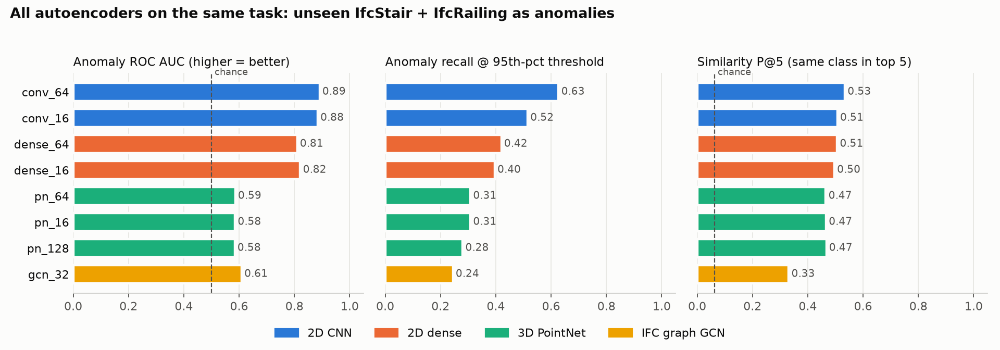
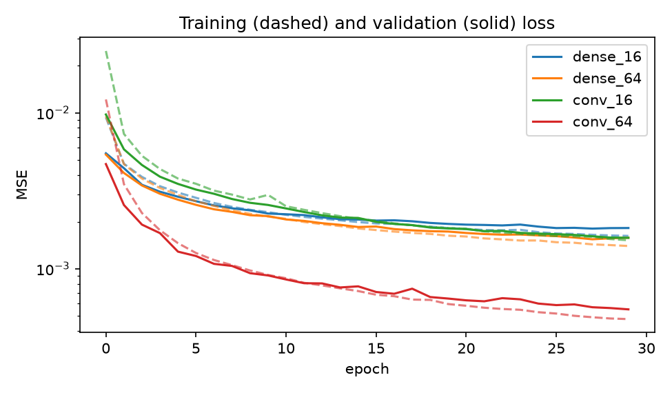
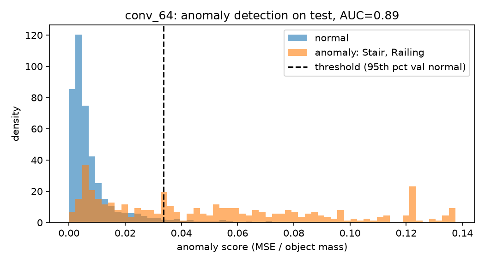
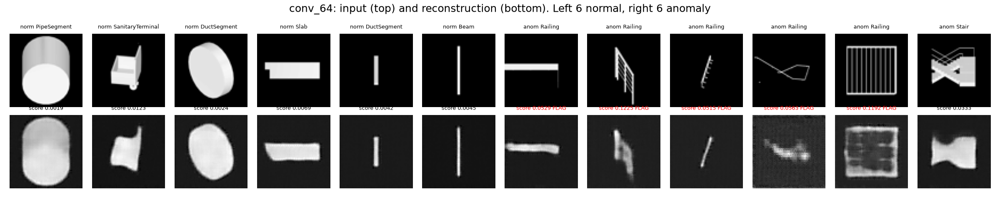
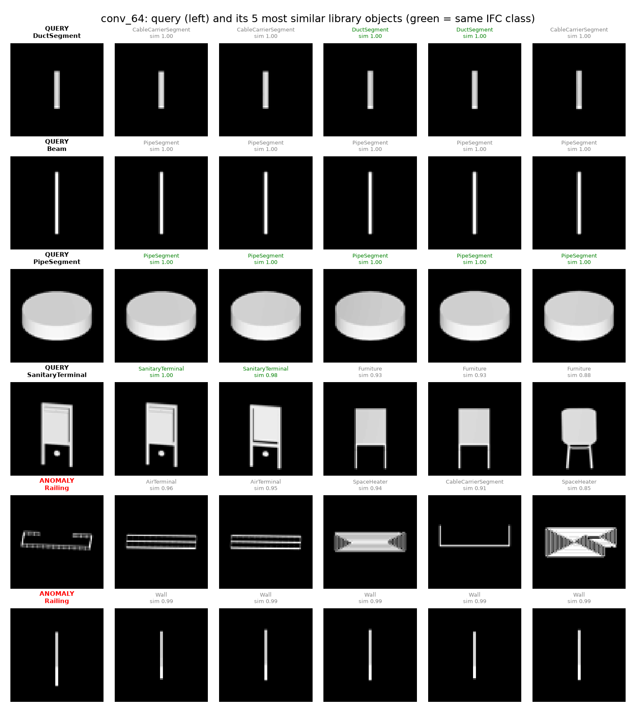
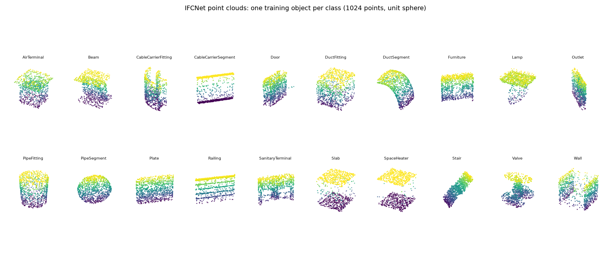
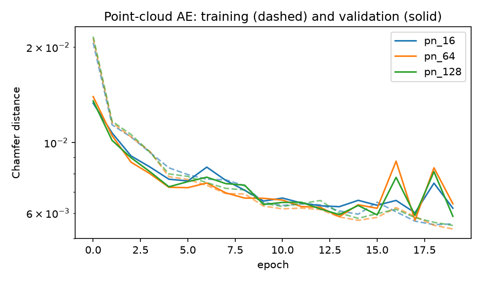
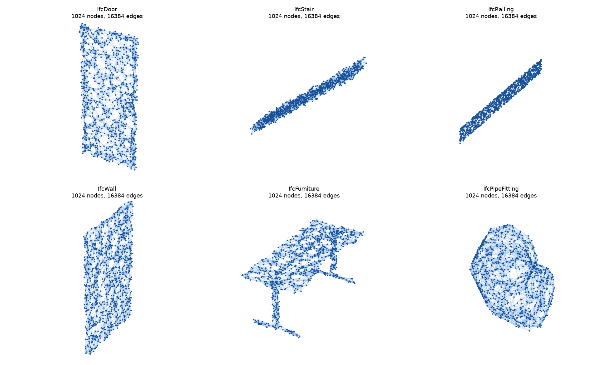

# 01_autoencoder: Conclusion

**Task:** an autoencoder that learns what 18 normal IFC element types look like, then
(1) flags unusual elements by their reconstruction error (anomaly detection) and
(2) finds the 5 most similar elements from its latent vector (similarity search).
`IfcStair` and `IfcRailing` are never shown during training and are used as the anomalies in the test.

We tried three ways to feed an IFC element to an autoencoder:

| Notebook | Input | Models compared |
|---|---|---|
| [autoencoder.ipynb](notebook/autoencoder.ipynb) | 2D renders, 64 x 64 greyscale (3 views per object) | dense_16, dense_64, conv_16, conv_64 |
| [pointcloud.ipynb](notebook/pointcloud.ipynb) | 3D point cloud, 1,024 points (IFCNet PLY) | PointNet AE, latent 16 / 64 / 128 |
| [ifcautoencoder.ipynb](notebook/ifcautoencoder.ipynb) | Graph from the IFC geometry: 1,024 surface points + 16-NN edges | GCN AE, latent 32 |

All use the same idea for the verdict: threshold = 95th percentile of the score on normal validation objects.

## All results together

| Input | Model | Params | ROC AUC | Precision | Recall | P@5 |
|---|---|---|---|---|---|---|
| 2D render | **conv_64** | 593,009 | **0.891** | **0.467** | **0.627** | **0.534** |
| 2D render | conv_16 | 199,745 | 0.884 | 0.449 | 0.515 | 0.507 |
| 2D render | dense_16 | 4,334,864 | 0.821 | 0.399 | 0.396 | 0.496 |
| 2D render | dense_64 | 4,347,200 | 0.810 | 0.391 | 0.420 | 0.506 |
| 3D point cloud | pn_64 | 1,783,104 | 0.586 (kNN: 0.739) | 0.268 | 0.308 | 0.465 |
| 3D point cloud | pn_16 | 1,758,480 | 0.585 (kNN: 0.742) | 0.260 | 0.308 | 0.466 |
| 3D point cloud | pn_128 | 1,815,936 | 0.584 (kNN: 0.735) | 0.247 | 0.280 | 0.467 |
| IFC graph | gcn_32 | 1,745,184 | 0.609 (kNN: 0.660) | 0.261 | 0.245 | 0.331 |

Baselines for P@5: random 0.06 · raw pixels 0.504 (2D) · raw coordinates 0.384 (graph points).
"kNN" = alternative anomaly score: mean cosine distance of the latent vector to its 5 nearest normal training objects.
Sources: [comparison.csv](comparison.csv), [comparison_3d.csv](comparison_3d.csv), [comparison_graph.csv](comparison_graph.csv).

## 2D renders (best family)

Training curves: the convolutional models reach a much lower validation error, and conv_64 is lowest.

The anomaly score separates normal objects from stairs and railings well.

## 3D point cloud (PointNet)

- Reconstruction error barely separates the anomalies (AUC about 0.59). The error mostly follows how **complex** an element type is: valves, pipe fittings and furniture have errors as high as railings.
- Distance in latent space (kNN) works better: AUC about 0.74.
- Latent size (16 / 64 / 128) makes almost no difference.
- **Corruption test** (broken versions of normal objects, see [corruption_3d.csv](corruption_3d.csv)): missing part AUC 0.59 / 0.74 (recon / kNN), wrong scale 0.49 / 0.61, noisy export 0.55 / 0.60. Broken geometry is **not** found reliably.

## IFC graph (GCN)

- The data pipeline works: 7,927 of 7,930 IFC files converted (99.96 %), 98.5 % of graphs in one piece, and only geometry goes into the model (no class, name or properties).
- The GCN autoencoder is the weakest model: anomaly AUC 0.61, recall 0.24, and P@5 0.33, **below** the raw-coordinate baseline (0.38). Mean pooling over 1,024 points with three GCN layers gives a blurry latent vector, and the MLP decoder cannot rebuild detailed shapes.
- Values come from the best saved checkpoint (`data/gcn_autoencoder.pt`, 30 epochs on CPU, Chamfer loss on 256 points). Its Chamfer values use a different setup from PointNet's, so only AUC and P@5 are compared across models.

## Which model worked best

**conv_64, the convolutional autoencoder on 2D renders.** It wins on every measure:

- **Anomaly detection:** ROC AUC **0.89** and it finds **63 %** of the unseen stairs and railings, against 0.58 to 0.61 for the 3D models.
- **Similarity:** P@5 **0.53**, the highest of all models (3D: 0.47, graph: 0.33).
- **Small and fast:** 593 k parameters (3 to 7 times fewer than the others), trained in about 2.5 minutes on a CPU, exports to ONNX.

That is why the model app ([model_app/](model_app/)) and the Hugging Face model use conv_64.

## Summary

- Convolutions on images beat dense layers on images, and images beat raw 3D geometry for this task in our setup.
- The 3D approaches (point cloud and graph) are closer to real IFC data but, as trained here, the reconstruction error measures *how complex* an element is, not *how unusual* it is. Their latent space is more useful than their reconstruction error.
- None of the models is reliable enough to work alone: even conv_64 has precision 0.47, so about half of its alarms are false. It is a **screening tool** that tells a BIM coordinator where to look, not an automatic checker.
- **Limitations:** only two anomaly classes, one seed, small inputs (64 px or 1,024 points), short CPU training, clean renders only.
- **Next steps for 3D:** a stronger encoder (DGCNN / pretrained point features), a better decoder, keeping real dimensions instead of scaling to the unit sphere, and longer GPU training.
