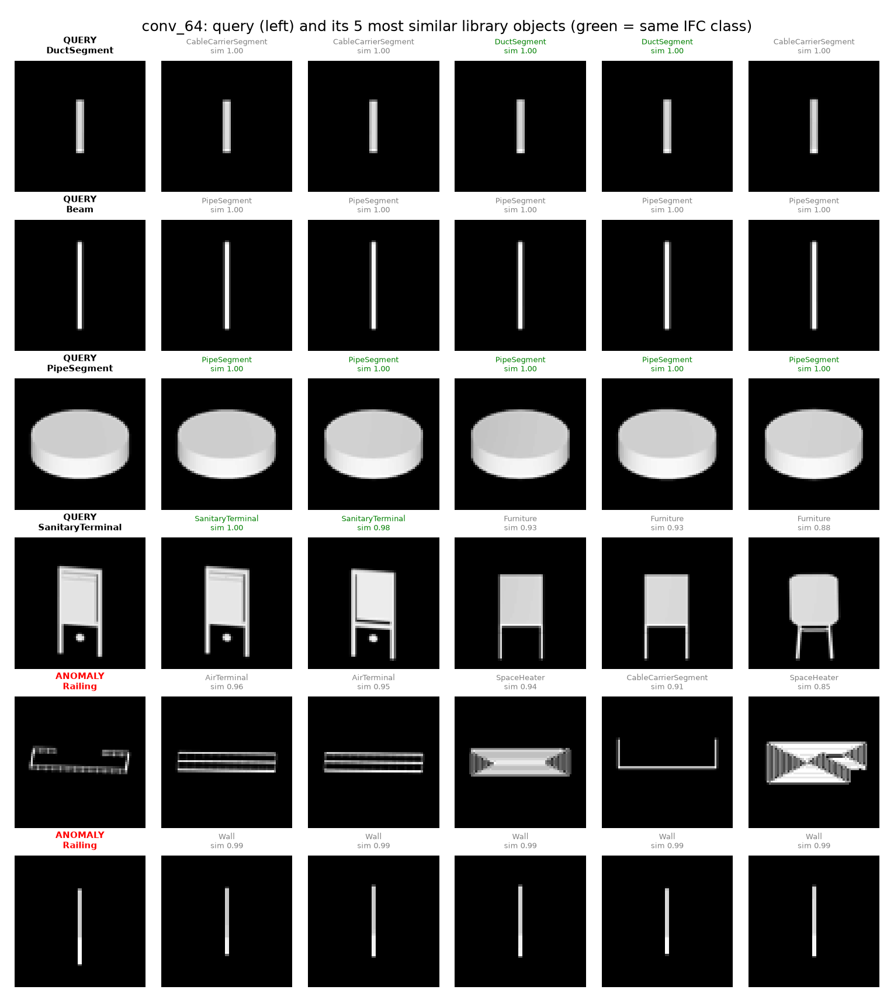
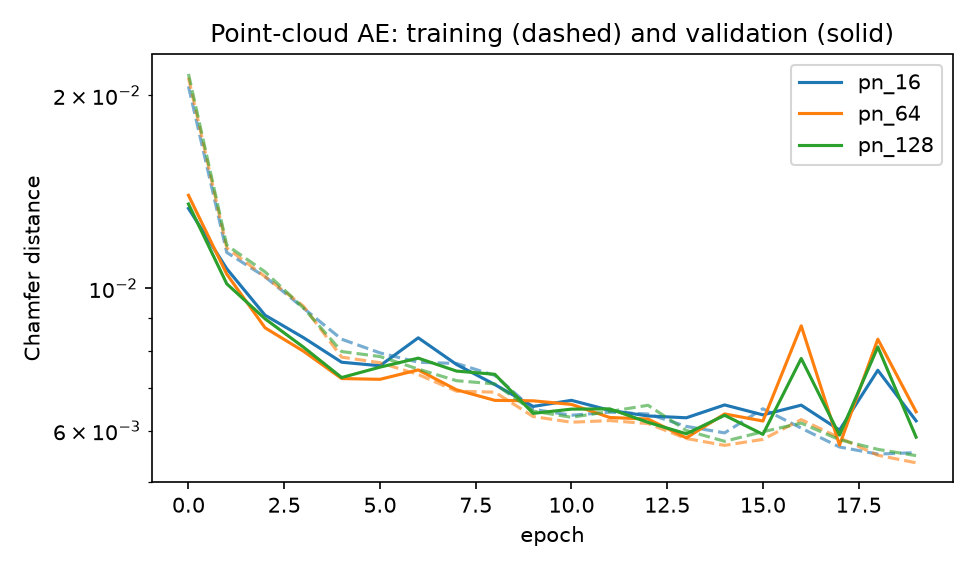
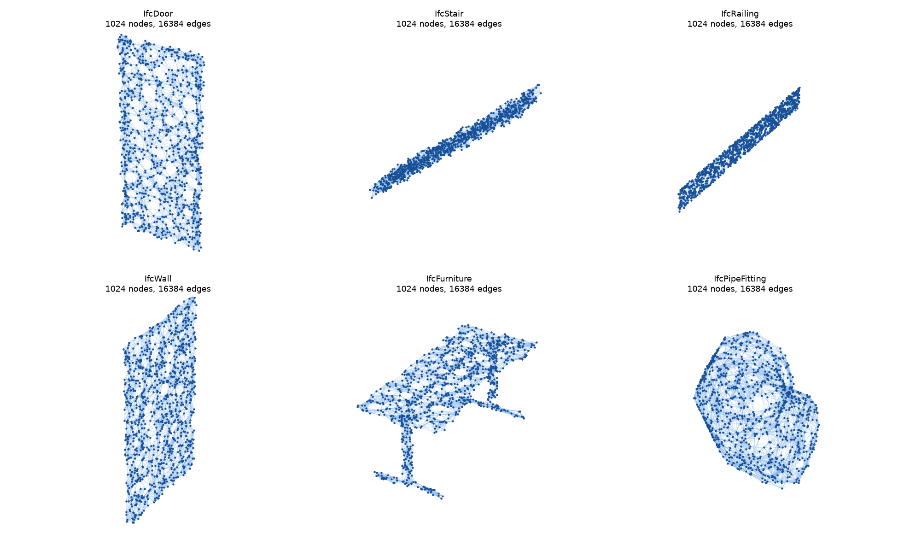

# 01_autoencoder

## Use case
We train an autoencoder on 18 types of BIM elements. If it cannot rebuild an element well (high reconstruction error), the element is unusual and a person should check it. For a user, the output is a **score** and a **verdict: "typical" or "unusual object, check it"**. As a second feature, the latent vector finds the **5 most similar elements**.

We tried three inputs for the same task. The full comparison is in [`CONCLUSION.md`](CONCLUSION.md).

| Notebook | Input | Best model | ROC AUC | P@5 |
|---|---|---|---|---|
| [`autoencoder.ipynb`](notebook/autoencoder.ipynb) | 2D renders, 64 x 64 greyscale | conv_64 | **0.891** | **0.534** |
| [`pointcloud.ipynb`](notebook/pointcloud.ipynb) | 3D point cloud, 1,024 points | pn_64 | 0.586 (kNN 0.739) | 0.465 |
| [`ifcautoencoder.ipynb`](notebook/ifcautoencoder.ipynb) | IFC geometry as a graph (1,024 points + 16-NN edges) | gcn_32 | 0.609 (kNN 0.660) | 0.331 |

The **model server** (`02_model_server/`) uses the graph model, because it reads the IFC file itself. The 2D model scores best and stays on Hugging Face as the reference.

## Dataset
| | |
|---|---|
| Name | IFCNet (IFCNetCore): multi-view PNG renders, PLY point clouds and the original IFC files |
| Source | https://ifcnet.e3d.rwth-aachen.de/ |
| Description | BIM objects in 20 IFC classes, one element per file |
| Used (2D) | 3 views per object, max 300 objects per class, 64 x 64 greyscale · 11,931 train / 1,986 val / 7,137 test images |
| Used (graph) | 7,927 of 7,930 IFC files converted (99.96 %); split by object in [`splits/ifc_split.csv`](splits/ifc_split.csv) |
| Licence | Not stated; used for non-commercial academic coursework only, not re-uploaded |
| Cite | Emunds et al. (2021), "IFCNet: A Benchmark Dataset for IFC Entity Classification", arXiv 2106.09712 |

**Anomaly setup:** trained on 18 normal classes only. `IfcStair` and `IfcRailing` are the anomalies, unseen until the test.

## How to run
1. Follow **Setup** in the root README (environment and data download).
2. Open a notebook in `notebook/` with the `hackathon` kernel and run all cells.
3. The first run builds a cache in `data/`; later runs are much faster. The graph notebook converts all IFC files once (about 11 minutes on a laptop CPU).

## 1. 2D renders (Monday)
Same split and seed, 30 epochs. Score = reconstruction error / object pixel mass. Threshold = 95th percentile of the score on normal validation images. P@5 = share of the 5 nearest neighbours (cosine, latent space) with the same IFC class.

| Model | Parameters | Val MSE | Test MSE | ROC AUC | Precision | Recall | P@5 |
|---|---|---|---|---|---|---|---|
| dense_16 | 4,334,864 | 0.00179 | 0.00180 | 0.821 | 0.399 | 0.396 | 0.496 |
| dense_64 | 4,347,200 | 0.00154 | 0.00154 | 0.810 | 0.391 | 0.420 | 0.506 |
| conv_16 | 199,745 | 0.00158 | 0.00158 | 0.884 | 0.449 | 0.515 | 0.507 |
| **conv_64** | 593,009 | **0.00055** | **0.00056** | **0.891** | **0.467** | **0.627** | **0.534** |

Similarity baselines: raw pixels P@5 = 0.504, random = 0.063.

**Conclusion:** conv_64 is the best model on every measure: ROC AUC 0.89, and it finds 63% of the anomalies. Convolutional models beat dense ones with 7 to 22 times fewer parameters. A bigger latent lowers the reconstruction error a lot but barely changes the AUC. For similarity, conv_64 is only a little better than comparing raw pixels (0.53 vs 0.50).

## 2. 3D point cloud
PointNet autoencoder on 1,024 points per element (IFCNet PLY), Chamfer loss, latent 16 / 64 / 128 ([`comparison_3d.csv`](comparison_3d.csv)).

- The reconstruction error barely separates the anomalies (AUC about 0.59); it mostly follows how complex an element type is.
- The distance in latent space (kNN) works better: AUC about 0.74.
- Latent size makes almost no difference. Broken versions of normal elements are not found reliably ([`corruption_3d.csv`](corruption_3d.csv)).

## 3. IFC geometry as a graph (Tuesday)
Each IFC file becomes a graph: IfcOpenShell mesh → 1,024 surface points → unit sphere → each point linked to its 16 nearest points. Only geometry goes into the model, never the IFC class, name or properties. Code: [`src/ifc_graph.py`](src/ifc_graph.py), model: [`src/graph_autoencoder.py`](src/graph_autoencoder.py).

- **Model:** 3 graph convolution layers (`GCNConv`, no convolutional layers on images), mean pooling, 32-number latent vector, MLP decoder; 1,745,184 parameters; Chamfer loss; 30 epochs on CPU.
- **Results** ([`comparison_graph.csv`](comparison_graph.csv)): ROC AUC 0.609 (kNN 0.660), precision 0.261, recall 0.245, P@5 0.331, below the raw-coordinate baseline (0.384).
- **Why weak:** mean pooling over 1,024 points blurs the shape into one vector, and the MLP decoder cannot rebuild details.

## Models
| Model | Hugging Face | Used by |
|---|---|---|
| gcn_32 (IFC graph) | https://huggingface.co/iaac-maai/hackathon-team2-ifcnet-gcn | model server ([`02_model_server/`](../02_model_server/)) |
| conv_64 (2D renders) | https://huggingface.co/iaac-maai/hackathon-team2-ifcnet-ae | reference; `model_app/` holds its config, gallery and examples |

The model cards are in `models/README.md` (conv_64) and `models_gcn/README.md` (gcn_32). ONNX files are on Hugging Face, not in git.

## Limitations
- Many false alarms even for the best model (precision 0.47): anomalies are only 6% of the test set.
- Only two anomaly classes, both thin objects.
- Similarity is weak in all models; the latent space learns shape, not IFC class.
- The 3D models (point cloud, graph) score much lower than the 2D one in this first version.
- Small setup: 64 px or 1,024 points, one seed, 30 epochs on CPU; losses were still falling.