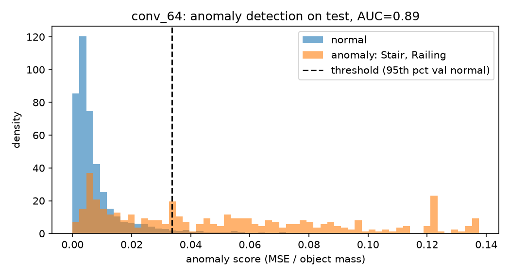
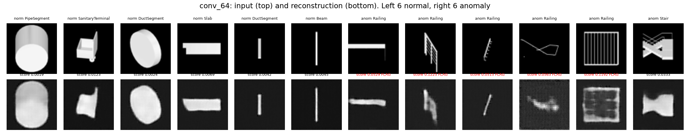

# 01_autoencoder: Monday

## Use case
We train an autoencoder on renders of 18 types of BIM elements. If it cannot rebuild an element well (high reconstruction error), the element is unusual and a person should check it. For a user, the output is a **score** and a **verdict: "typical" or "unusual object, check it"**. As a second feature, the latent vector finds the **5 most similar elements**.

## Dataset
| | |
|---|---|
| Name | IFCNet (IFCNetCore, multi-view PNG renders) |
| Source | https://ifcnet.e3d.rwth-aachen.de/ |
| Description | BIM objects in 20 IFC classes, 12 views per object |
| Used | 3 views per object, max 300 objects per class, 64 x 64 greyscale · 11,931 train / 1,986 val / 7,137 test images |
| Licence | Not stated; used for non-commercial academic coursework only, not re-uploaded |
| Cite | Emunds et al. (2021), "IFCNet: A Benchmark Dataset for IFC Entity Classification", arXiv 2106.09712 |

**Anomaly setup:** trained on 18 normal classes only. `IfcStair` and `IfcRailing` are the anomalies, unseen until the test (429 of 7,137 test images).

## How to run
1. Follow **Setup** in the root README (environment and data download).
2. Open `notebook/autoencoder.ipynb` with the `hackathon` kernel and run all cells.
3. The first run builds a cache in `data/` (about 8 minutes); later runs take seconds.

## Setups compared
Same split and seed, 30 epochs. Score = reconstruction error / object pixel mass. Threshold = 95th percentile of the score on normal validation images. P@5 = share of the 5 nearest neighbours (cosine, latent space) with the same IFC class.

| Model | Parameters | Val MSE | Test MSE | ROC AUC | Precision | Recall | P@5 |
|---|---|---|---|---|---|---|---|
| dense_16 | 4,334,864 | 0.00179 | 0.00180 | 0.821 | 0.399 | 0.396 | 0.496 |
| dense_64 | 4,347,200 | 0.00154 | 0.00154 | 0.810 | 0.391 | 0.420 | 0.506 |
| conv_16 | 199,745 | 0.00158 | 0.00158 | 0.884 | 0.449 | 0.515 | 0.507 |
| **conv_64** | 593,009 | **0.00055** | **0.00056** | **0.891** | **0.467** | **0.627** | **0.534** |

Similarity baselines: raw pixels P@5 = 0.504, random = 0.063.

**Conclusion:** conv_64 is the best model on every measure: ROC AUC 0.89, and it finds 63% of the anomalies. Convolutional models beat dense ones with 7 to 22 times fewer parameters. A bigger latent lowers the reconstruction error a lot but barely changes the AUC. For similarity, conv_64 is only a little better than comparing raw pixels (0.53 vs 0.50).

## Result

## Model
Hugging Face: https://huggingface.co/iaac-maai/hackathon-team2-ifcnet-ae
`model_app/` holds the config, `gallery.npz` (latent vectors for similarity search) and example inputs for the model server. The ONNX file is on Hugging Face.

## Limitations
- Many false alarms (precision 0.47): anomalies are only 6% of the test set.
- Only two anomaly classes, both thin objects; the score depends on object size.
- Similarity is weak: about half of the 5 neighbours share the IFC class, close to raw pixels.
- Trained on clean renders; real Revit or Rhino screenshots may look different.
- Small setup: 64 px, 3 views per object, one seed; losses were still falling at epoch 30.