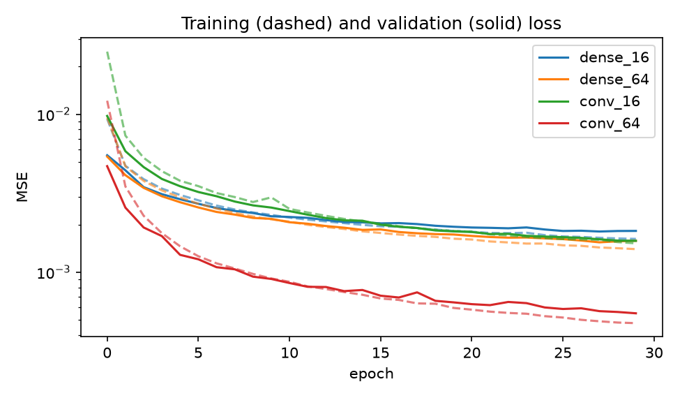
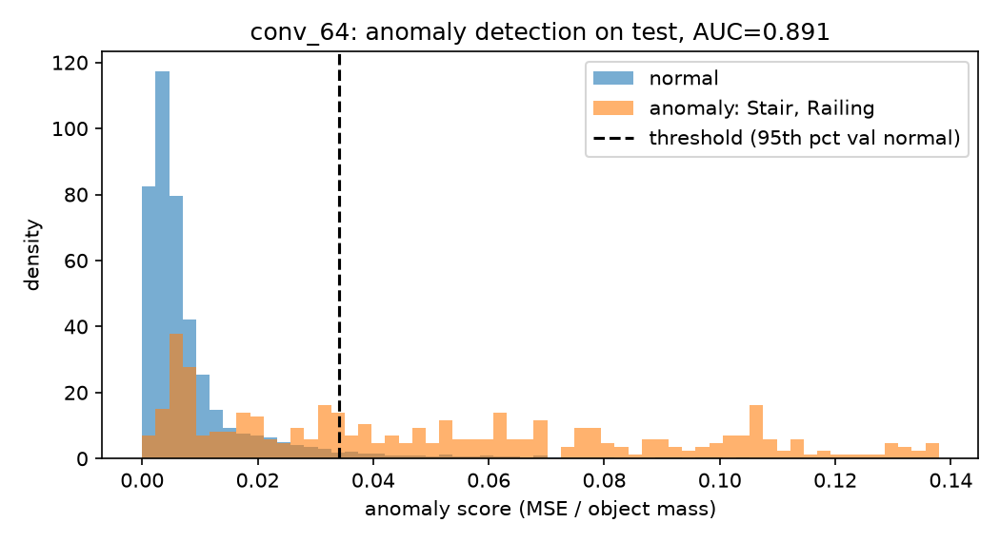
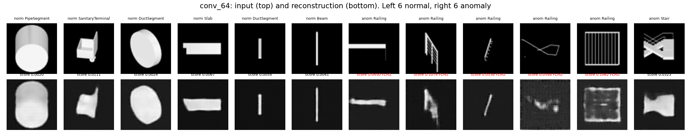

# hackathon-team2-ifcnet-ae: BIM element anomaly detector

A small convolutional autoencoder that learned what 18 common types of BIM elements look like (IFCNet renders). If it cannot rebuild an element well, the element is **unusual** and a person should check it.

Built in the AI Methods I hackathon, Master in AI for Architecture & Business Innovation (MaAI), IAAC, November 2026.
Code: https://github.com/iaac-maai/hackathon-team2-ifcnet

## Use case
**BIM Element Checker:** a BIM coordinator uploads a render or screenshot of one element. The model returns a score and a verdict: *typical* or *unusual object, check it*.

## Data
- **IFCNet** (IFCNetCore, multi-view PNG renders), 20 IFC classes, 12 views per object. https://ifcnet.e3d.rwth-aachen.de/
- Used: 3 views per object, at most 300 objects per class, 64 x 64 greyscale. 11,931 train, 1,986 val, 7,137 test images. Validation split by object.
- **Normal (training) classes:** 18 classes (AirTerminal, Beam, CableCarrierFitting, CableCarrierSegment, Door, DuctFitting, DuctSegment, Furniture, Lamp, Outlet, PipeFitting, PipeSegment, Plate, SanitaryTerminal, Slab, SpaceHeater, Valve, Wall).
- **Anomaly classes (test only):** `IfcStair`, `IfcRailing`.
- **Licence:** not stated by the dataset authors. Used for non-commercial academic coursework only. The dataset is not re-uploaded here.
- **Cite:** Emunds, C. et al. (2021) "IFCNet: A Benchmark Dataset for IFC Entity Classification", arXiv 2106.09712.

## Model
- Convolutional autoencoder (`conv_64`), latent size 64, 593,009 parameters. Linear output layer.
- **Input** `image`: float32 `[batch, 1, 64, 64]`.
- **Preprocessing:** greyscale, resize to 64 x 64, scale to 0-1, invert (`x = 1 - x`, object bright on a dark background).
- **Outputs:** `reconstruction` `[batch, 1, 64, 64]`, `latent` `[batch, 64]` (for similarity search) and `score` `[batch]` = reconstruction MSE divided by the object's pixel mass (mean pixel value + 0.001).
- **Decision:** `score > threshold` means "unusual object, check it". Threshold 0.0340 = 95th percentile of the score on normal validation images (see `config.json`).

## Training and comparison
Same split and seed for all setups; 30 epochs, Adam (lr 1e-3), batch 128, MSE loss, best epoch by validation MSE. CPU.

| Model | Parameters | Val MSE | Test MSE | ROC AUC | Precision | Recall |
|---|---|---|---|---|---|---|
| dense_16 | 4,334,864 | 0.00179 | 0.00180 | 0.821 | 0.399 | 0.396 |
| dense_64 | 4,347,200 | 0.00154 | 0.00154 | 0.810 | 0.391 | 0.420 |
| conv_16 | 199,745 | 0.00158 | 0.00158 | 0.884 | 0.449 | 0.515 |
| **conv_64 (this model)** | 593,009 | **0.00055** | **0.00056** | **0.891** | **0.458** | **0.629** |



## Results




## Limits: where the model fails
- **Many false alarms:** precision 0.46. Anomalies are 6% of the test set, and the threshold flags 5% of normal images.
- **Misses a third of the anomalies** (recall 0.63), mostly railings and stairs that are simple, compact shapes.
- **Size bias:** plain MSE ranked thin objects as *more* normal; the score divides by pixel mass to fix this, so very small or very large objects can still be scored wrongly.
- **Clean renders only:** trained on IFCNet renders. Real Revit or Rhino screenshots (other angles, colours, backgrounds) may score as unusual.
- **Small setup:** 64 px, 3 views per object, at most 300 objects per class, one seed; not fully trained.

## How to use
```python
import json
import numpy as np
import onnxruntime as ort
from PIL import Image
from huggingface_hub import hf_hub_download

repo = "iaac-maai/hackathon-team2-ifcnet-ae"
model_path = hf_hub_download(repo, "model.onnx")
cfg = json.load(open(hf_hub_download(repo, "config.json")))

def preprocess(path, size=cfg["preprocessing"]["img_size"]):
    im = Image.open(path).convert("L").resize((size, size))
    x = 1 - np.asarray(im, np.float32) / 255          # object bright on dark
    return x[None, None]                              # [1, 1, 64, 64]

sess = ort.InferenceSession(model_path, providers=["CPUExecutionProvider"])
reconstruction, latent, score = sess.run(["reconstruction", "latent", "score"],
                                         {"image": preprocess("my_element.png")})
verdict = "unusual object, check it" if score[0] > cfg["threshold"] else "typical"
print(f"score {score[0]:.4f} -> {verdict}")
```

## Credits
Team 2 (Bars Babila, Samiha Abeda Nur, Emmanuel Marquez, Karthikeyan Seravanan), AI Methods I hackathon, IAAC MaAI 2026/27. Faculty: Salvador Cantuarias Brañes and Serjoscha Düring.