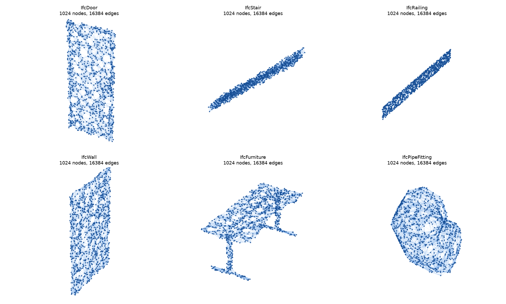
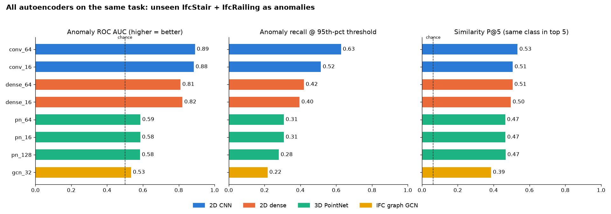

# IFC element check: GCN graph autoencoder (IAAC MaAI, Team 2)

A small **graph autoencoder** that reads the 3D geometry of one IFC building element and answers two questions:

1. **Is this element unusual?** The model rebuilds the element's shape; a large reconstruction error means it does not look like the 18 normal element types it learned.
2. **What is it similar to?** The 32-number latent vector can be compared with other elements to find the most similar ones.

It works **directly on the IFC geometry**, not on rendered images. Only geometry goes into the model: the IFC class, name and properties are never used as input.

- **Live demo / API:** https://hackathon-team2-ifcnet.onrender.com (free instance: the first request can take about 50 s)
- **Code:** https://github.com/iaac-maai/hackathon-team2-ifcnet (`01_autoencoder/` for training, `02_model_server/` for the server)
- **Course:** AI Methods I hackathon, Master in AI for Architecture (MaAI), IAAC Barcelona, November 2026



## How an IFC element becomes model input

```
IFC file -> triangle mesh (IfcOpenShell, world coordinates, metres)
         -> 1,024 points sampled on the surface (area-weighted, seed 42)
         -> centred and scaled into the unit sphere (shape only, no size or position)
         -> each point linked to its 16 nearest points (kNN graph)
```

| Input | Shape | Meaning |
|---|---|---|
| `x` | `[1024, 3]` float32 | normalised x, y, z of each point (node features) |
| `edge_index` | `[2, 16384]` int64 | kNN edges, row 0 = neighbour, row 1 = point |

| Output | Shape | Meaning |
|---|---|---|
| `reconstruction` | `[1, 1024, 3]` | the rebuilt point cloud |
| `latent` | `[1, 32]` | the latent vector (for similarity search) |

The exact preprocessing settings are stored in `config.json`. Use the same code (`ifc_graph.py` in the GitHub repo) to prepare new elements.

## Model

- **Encoder:** 3 graph convolution layers (`GCNConv`, 3 → 64 → 128 → 128, ReLU), global mean pooling, linear layer to a **32-number latent vector**.
- **Decoder:** MLP (32 → 256 → 512 → 1,024 × 3) that outputs 1,024 points.
- **Parameters:** 1,745,184.
- **Loss:** symmetric squared Chamfer distance (computed on a fixed subset of 256 points to keep CPU memory low).
- **Training:** 30 epochs on CPU, normal classes only; the best checkpoint is chosen by validation Chamfer distance.

## Anomaly score and threshold

- **Score:** squared Chamfer distance between the input points and the reconstruction (first 256 points).
- **Threshold:** 0.039336, the 95th percentile of the score on **normal validation** elements.
- **Decision:** score > threshold → `unusual`.

## Data

**IFCNetCore** (Emunds et al. 2021, arXiv 2106.09712): 7,930 single-element IFC files in 20 classes. 7,927 were converted (99.96 %); 3 failed (2 `IfcPlate` shapes IfcOpenShell could not build, 1 `IfcValve` that crashed the geometry engine).

- **Normal classes (18):** used for training.
- **Anomaly classes (2):** `IfcStair` and `IfcRailing`, never seen in training, used only to test anomaly detection.
- **Test set:** 2,377 elements, of which 143 are anomalies.

IFCNet has no licence stated. It is used for non-commercial academic coursework only and is not re-uploaded here.

## Results

| Input | Model | ROC AUC | Precision | Recall | P@5 (similarity) |
|---|---|---|---|---|---|
| 2D renders | conv_64 (CNN) | **0.891** | **0.467** | **0.627** | **0.534** |
| 3D point cloud | PointNet AE (pn_64) | 0.586 (kNN 0.739) | 0.268 | 0.308 | 0.465 |
| **IFC graph** | **GCN AE (this model)** | **0.534** | **0.231** | **0.217** | **0.386** |

- **kNN** = alternative anomaly score: mean cosine distance of the latent vector to its 5 nearest normal training elements.
- **P@5** = share of the 5 most similar elements (by latent vector) that have the same IFC class. Baselines: random 0.06; raw point coordinates 0.380.



**What this means.** The graph model works end to end on real IFC geometry, but in this first version it is the **weakest** of our three approaches:

- Anomaly detection is only a little better than chance (AUC 0.53), and it finds 22 % of the unseen stairs and railings.
- Similarity search (P@5 0.386) is only just above the raw-coordinate baseline (0.380): the latent vector captures shape about as well as the raw points, not better.
- Likely reasons: mean pooling over 1,024 points blurs the shape into one vector, the MLP decoder cannot rebuild fine details, and training was short (30 CPU epochs).

## How to use

```python
import json
import numpy as np
import onnxruntime as ort
from huggingface_hub import hf_hub_download
import ifc_graph  # from the GitHub repo: 02_model_server/ifc_graph.py

repo = "iaac-maai/hackathon-team2-ifcnet-gcn"
cfg = json.load(open(hf_hub_download(repo, "config.json")))
sess = ort.InferenceSession(hf_hub_download(repo, "model.onnx"))

points, edge_index, _ = ifc_graph.ifc_to_arrays("element.ifc")
recon, latent = sess.run(None, {"x": points, "edge_index": edge_index})

n = cfg["score_points"]
d = ((recon[0, :n, None, :] - points[None, :n, :]) ** 2).sum(-1)
score = d.min(1).mean() + d.min(0).mean()
print("score", score, "unusual", score > cfg["threshold"])
```

Or call the live server with `gradio_client`:

```python
from gradio_client import Client, handle_file
client = Client("https://hackathon-team2-ifcnet.onrender.com")
print(client.predict(handle_file("element.ifc"), api_name="/predict"))  # score, threshold, unusual
print(client.predict(handle_file("element.ifc"), api_name="/embed"))    # latent vector
```

## Limitations

- **Not reliable on its own.** Use it as a research prototype, not as a checker for real projects.
- Only two anomaly classes (stairs and railings); "unusual" here means "not one of the 18 learned types", not "badly modelled".
- Size is removed by the normalisation, so a wrongly scaled element looks normal.
- One element per IFC file; whole building models are not supported yet.
- One seed, short CPU training, 1,024 points per element.

## Next steps

A stronger encoder (e.g. DGCNN / EdgeConv), a better decoder, keeping real dimensions, using IFC relations between elements as graph edges, and longer GPU training.

## Authors and AI use

Team 2: Bars Babila, Samiha Abeda Nur, Emmanuel Marquez, Karthikeyan Saravanan.
AI assistants were used for code and documentation support; the AI usage disclosure is in the GitHub repository README.