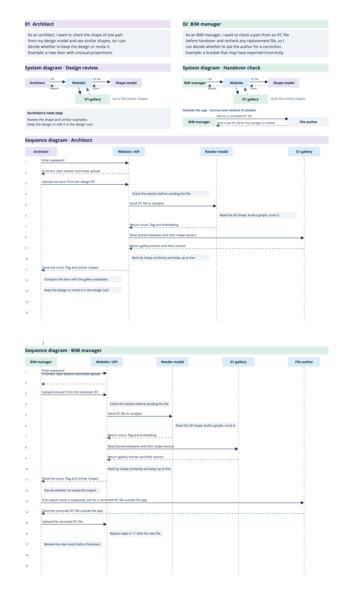

# 03_app: Wednesday

A password-protected web app on Cloudflare. Upload **one IFC element** (`.ifc`): the app sends it to our model server on Render, shows whether the element is **normal** or **unusual**, lists the **5 most similar elements** from a reference gallery, and saves every result in a database.

| | |
|---|---|
| **Live app** | https://hackathon-ifc-app.pages.dev |
| **Model server** | https://hackathon-team2-ifcnet.onrender.com (see [`02_model_server/`](../02_model_server)) |
| **Based on** | the class example `hackathon/docs/cloudflare_app/` (notebook 2, section 3) |

## How to log in

The app asks for the **team password**. It is **not in this repository**: ask a team member.

The password is checked **on the server**, never in the browser. It is stored as an encrypted Cloudflare secret (`APP_PASSWORD`). `functions/_middleware.js` runs before every request: without the right cookie you only get the login page, and the API answers `401`. The cookie holds a hash of the password, not the password.

## What it does

1. You upload an `.ifc` file (one element, max 5 MB).
2. The page sends it to `/api/predict`, a Cloudflare function.
3. The function sends the file as base64 to the model server's `analyse` endpoint (Gradio API, two calls: start a job, then read its result).
4. The model answers with an anomaly **score** (Chamfer distance between the element and its reconstruction), the **threshold**, the verdict **`unusual`** (score above the threshold) and the element's **embedding** (32 numbers that describe its shape).
5. The function saves one row in D1, then compares the embedding with the **gallery** (370 IFCNet elements, also in D1) and keeps the 5 most similar.
6. The page shows the verdict, the score, how many times the threshold it is, and the 5 most similar elements with their IFC class.
7. **Saved results** lists the last 20 rows from D1, so they are still there after a reload.

Only the geometry is used, never the IFC class or name. The verdict is a hint, not a check: see the model's limits in [`02_model_server/README.md`](../02_model_server/README.md).

## Similarity search

The model compresses each element into an **embedding**: 32 numbers, scaled to length 1. Elements with similar shapes get similar embeddings. The similarity of two elements is the dot product of their embeddings (cosine similarity): **1 = same shape**, lower = more different.

- **The gallery.** `scripts/build_gallery.py` picks up to 20 **test** elements per IFC class (fixed seed, files known to fail are skipped) and asks the **same `analyse` API** for their embeddings, so the gallery and the app use exactly the same model and preprocessing. It writes `gallery.sql`, which fills the D1 table `gallery`. Built on 18 Nov: **370 elements, 20 classes**. 24 files timed out on the server (over 120 s), so a few classes have fewer: IfcSanitaryTerminal 11, IfcStair 12, IfcValve 15, the rest 18 to 20.
- **At each upload**, `predict.js` compares the new embedding with the 370 gallery rows and returns the 5 highest.
- **The IFC class is only shown to read the result**: the model never sees it.
- **What to expect.** In `01_autoencoder`, this model's **P@5 is 0.39**: on average about 2 of the 5 most similar elements have the same class (random: 0.06). A door whose neighbours include a plate is the model's limit, not an app error.
- **Same model only.** Each gallery row keeps the threshold of the model that made it (now 0.039336). If the model on Render changes, the threshold changes and the page warns *"The gallery was made with another model version"*. Then rebuild the gallery (about 2 hours through the free server) and load it again:

```bash
rm 03_app/.gallery_cache.jsonl                   # from the repo root; the cache holds the OLD model's embeddings
python 03_app/scripts/build_gallery.py           # resumes from the cache if it stops halfway
cd 03_app && npx wrangler d1 execute hackathon-ifc-db --remote --file=gallery.sql
```

## Cloudflare services and why

| Service | Job | Why |
|---|---|---|
| **Pages** | Serves the page (`public/`) | Free, fast static hosting. A static page cannot keep secrets, so it does no checking itself. |
| **Pages Functions** | Password gate, calls the model, saves the result (`functions/`) | Runs on Cloudflare's servers, so the password stays hidden. Python models cannot run here, which is why the model lives on Render. |
| **D1** | One row per result (`schema.sql`) and the similarity gallery (`gallery.sql`) | Results in the browser vanish on reload and are visible to one person only. D1 keeps them for everyone. The gallery is small (370 × 32 numbers), so the function can compare with all of it at each request. |
| **R2** | *Not used* | Cloudflare asks for a payment method to enable R2. As notebook 2 suggests in that case, we store only the results in D1, not the uploaded files. |

Tables:
- `predictions`: `id`, `created_at`, `file_name`, `score`, `threshold`, `is_anomaly` (1 = unusual). The embedding is not stored.
- `gallery`: `object_id`, `ifc_class`, `file_name`, `threshold`, `embedding` (JSON, 32 numbers).

## What happens when…

| Situation | What the app does | Where |
|---|---|---|
| **The model server is asleep** (Render free plan sleeps after 15 min) | After 5 s the page shows *"The model server is waking up. This takes about a minute"*. If there is still no answer, the function stops waiting (120 s to start, enough for Render's wake-up of 83 to 95 s measured on 19 Nov; 130 s for the result) and the page says to try again in a minute. *Tested on 19 Nov with a sleeping server: the message appeared, and a second try about a minute later gave the result.* | `index.html`, `predict.js` |
| **The IFC geometry cannot be read** | The model server answers with an error; the app shows *"The model could not read this IFC file"* (422). Nothing is saved. | `predict.js` |
| **A very heavy IFC** (e.g. detailed sanitary terminals) | The server gives up after 120 s with its own error. The function waits 130 s, so the user sees that error (422), not "waking up". | `predict.js` |
| **The gallery is missing, empty or from another model** | The verdict still works; a note replaces or follows the similar elements. | `predict.js` |
| **Not an `.ifc`, or larger than 5 MB** | Refused before anything is sent to the model (400 / 413). | `predict.js` |
| **Wrong password** | Back to the login page with a message. | `login.js` |
| **The page is reloaded** | The current result disappears, the saved results are read again from D1. | `index.html` |

The threshold is saved in each row, so each verdict stays consistent. Scores from different model versions are **not comparable**: if the model is retrained, old rows keep the old model's scores.

## Run it locally

Needs Node.js. From this folder:

```bash
npm install                 # installs Wrangler (version pinned in package.json)
# create .dev.vars with one line: APP_PASSWORD=<choose-a-password>   (git-ignored, never commit it)
npm run db:local            # creates the table in a local database (.wrangler/)
npx wrangler d1 execute hackathon-ifc-db --local --file=gallery.sql   # loads the similarity gallery
npm run dev                 # http://localhost:8788, calls the Render model server
```

## Deploy

Already done once; to publish code changes, only the last command is needed.

```bash
npx wrangler login
npx wrangler d1 create hackathon-ifc-db          # paste the database_id into wrangler.toml
npm run db:remote                                # creates the table online
npx wrangler d1 execute hackathon-ifc-db --remote --file=gallery.sql   # loads the gallery online
npx wrangler pages project create hackathon-ifc-app --production-branch main
npx wrangler pages secret put APP_PASSWORD       # type the password when asked
npm run deploy                                   # uploads public/ and functions/
```

## Files

| File | What it does |
|---|---|
| `wrangler.toml` | Project name, `MODEL_URL`, `MODEL_API_NAME`, the D1 binding. No secrets. |
| `schema.sql` | The `predictions` table |
| `functions/_middleware.js` | The password gate |
| `functions/api/login.js` | Checks the password, sets the cookie |
| `functions/api/predict.js` | Validates the file, calls the model, saves the row in D1, finds the 5 most similar gallery elements |
| `scripts/build_gallery.py` | Builds `gallery.sql` through the model server's `analyse` API |
| `gallery.sql` | The similarity gallery (370 embeddings), loaded into D1 |
| `functions/api/history.js` | The last 20 results |
| `public/index.html`, `login.html`, `style.css` | The pages |

## Diagrams vs. the real app

Two user stories (architect, IFC manager), a system diagram and a sequence diagram for each. Made in Miro.



The diagrams follow the real app: one call to `/analyse` returns the score, threshold, verdict and embedding, then the website ranks the gallery in D1. What they leave out or simplify:

- **"Render model" / "Shape model"** is the model server on Render (`02_model_server/`).
- **Saving the result** is not drawn: after step 7 the function also saves one row in the D1 table `predictions`, and the page reads the last 20 rows ("Saved results").
- **One element per file.** The app checks one IFC element at a time, so the user first exports the door or part as its own `.ifc` file.
- **No R2.** Uploaded files are not stored (Cloudflare asks for a payment method), only the results.
- **Waiting.** If the model server is asleep, the page shows a "waking up" message after 5 s; the diagrams show only the normal path. The failure cases are in the table above.
- **The gallery** (370 IFCNet test elements) was built in advance with `scripts/build_gallery.py`, through the same `analyse` API.
- **Correcting a file** (IFC manager, steps 13–16) happens outside the app; the app only rechecks the new file.