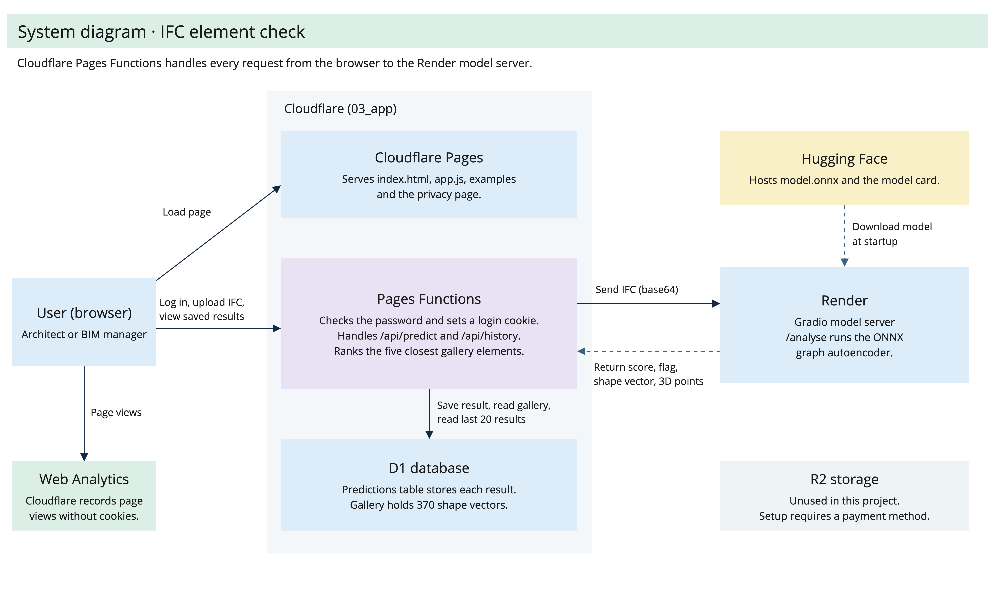
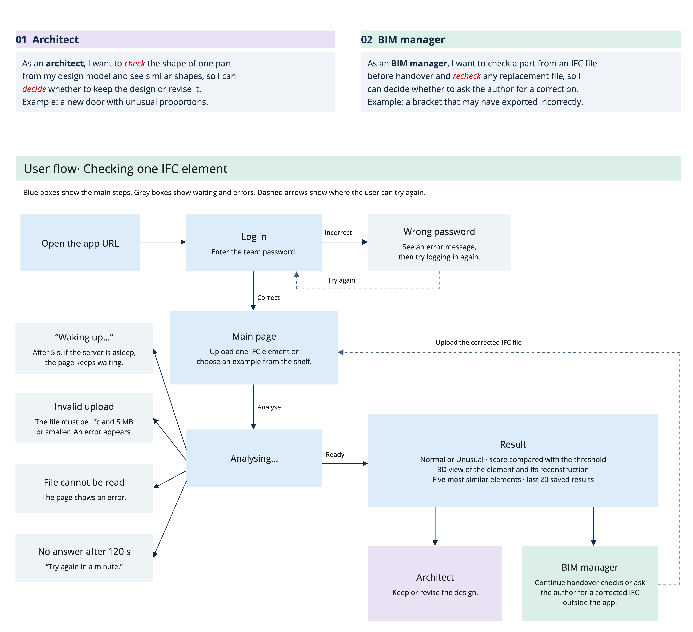
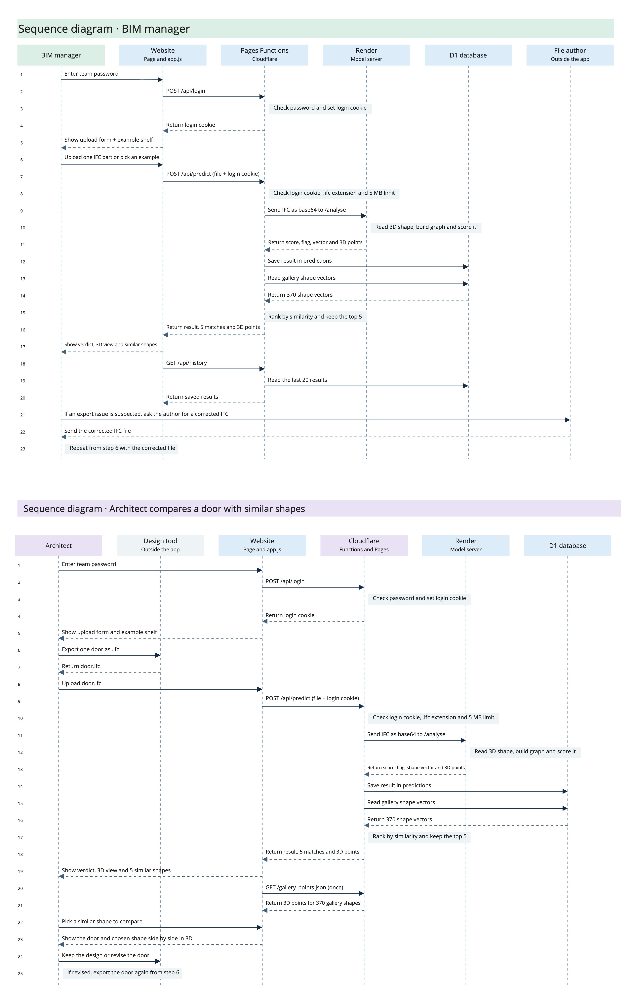

# Final: IFC Check

AI Methods I hackathon · IAAC MaAI 2026/27 · Team 2: Bars Babila, Samiha Abeda Nur, Emmanuel Marquez, Karthikeyan Saravanan

## Use case

A BIM coordinator checks a model before handover, and an architect checks an element while designing. They upload one IFC element and get:

- an **anomaly score** and a **Normal / Unusual** verdict from a graph autoencoder trained on 18 common IFC classes (IFCNet),
- the **5 most similar** elements from a reference gallery of 370 IFCNet elements (latent space),
- a **3D view** of the element's points next to the model's reconstruction,
- a saved row in the **history**, shared by the team.

A **whole-model check** shows a small house we modelled in Revit, split into its 56 elements, each with its score.

## Live

| Part | Link |
|---|---|
| App on Cloudflare Pages (password, sent to the instructors with the submission) | https://hackathon-ifc-app.pages.dev |
| Model server on Render (graph model, Gradio) | https://hackathon-team2-ifcnet.onrender.com |
| Graph model on Hugging Face | https://huggingface.co/iaac-maai/hackathon-team2-ifcnet-gcn |
| 2D model on Hugging Face (Monday, best AUC) | https://huggingface.co/iaac-maai/hackathon-team2-ifcnet-ae |

The Render free plan sleeps after 15 minutes. The first analysis after a pause can take up to about 1.5 minutes (we measured 83 to 95 s); the app shows a "waking up" message and waits up to 120 s.

## Code

The final app is in [`../03_app/`](../03_app/) (see its [README](../03_app/README.md)). The brief allows `04_final/app/` **or a link**; we keep one copy to avoid two versions drifting apart.

| Folder | What |
|---|---|
| `03_app/functions/_middleware.js` | password check before every request (Cloudflare secret `APP_PASSWORD`) |
| `03_app/functions/api/predict.js` | sends the file to Render (`/analyse`), saves the row in D1, finds the 5 most similar |
| `03_app/functions/api/history.js` | the saved results |
| `03_app/public/` | the website (upload, 3D view, example shelf, whole-model check, privacy page) |
| `03_app/scripts/` | build the gallery (via the Render API), the example shelf and the house view |
| `02_model_server/` | the Gradio model server on Render |

## Diagrams

### System

### User flow

### Sequence (BIM manager and architect)

**Not in the diagrams:** the whole-model check. Its scores are **precomputed offline** by `03_app/scripts/build_house.py` with the same `model.onnx`, preprocessing and threshold as the server, and served as static files (`public/house/`). Only its "Run live analysis" button calls the server, through the same `/api/predict` path shown above.

## Proofs

See [`PROOFS.md`](PROOFS.md): D1 database, locked on the server, connected to Render, no secrets in git or in the Cloudflare account.

## Where we stand

- **Clear:** Our app works end to end on real IFC geometry. You upload one element, a graph autoencoder on Render gives a score and a Normal / Unusual verdict, the website finds the 5 most similar elements, and the result is saved in D1 behind a password.
- **Unclear:** Whether the score really means "unusual". On unseen stairs and railings the AUC is only 0.53, close to chance, and similar shapes are often from another IFC class (P@5 0.39). The score seems to measure how complex an element is more than how unusual it is. Our 2D image model scores much better (AUC 0.89), but it cannot read the IFC file directly.
- **Next:** A stronger graph encoder (for example EdgeConv) and longer GPU training, keeping the real size of the element, and splitting a whole building model into elements, so an architect can check a full project instead of one element per file.

## Limitations

- **The anomaly score is weak.** Graph model AUC 0.53 on the unseen classes (stairs, railings); the 2D model reaches 0.89 but needs images, not the IFC file.
- **Size is lost.** Every element is scaled to a unit sphere, so a 1 m and a 10 m wall look the same to the model.
- **Similar is not same class.** Only 39% of the 5 nearest gallery elements share the IFC class (P@5 0.39).
- **The house shows no unusual elements.** All 56 elements score below the threshold, so this view does not yet prove the model can find a problem in a real project.
- **One element per file, up to 5 MB.** The upload does not split a full model; the house was split offline.
- **Shared team password, no accounts.** Everyone with the password sees all saved results, including file names (see the app's privacy page).
- **Cold start.** Render's free plan sleeps; the first request after a pause is slow.
